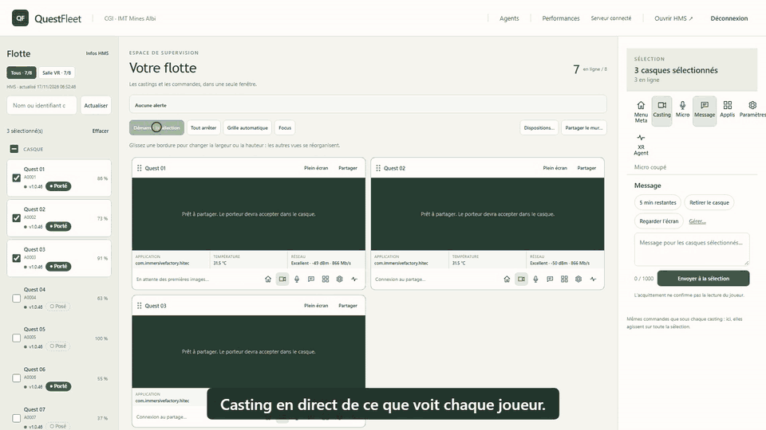

[English](README.md) · **Français**

# QuestFleet

**Un tableau de bord web et un agent sur chaque Meta Quest permettent à l'enseignant de voir, caster et piloter toute une salle de casques pendant un cours.**

*Le vrai tableau de bord, piloté avec des casques de démo ; le casting rejoue une session enregistrée dans un casque. [Vidéo complète (0:59)](https://drive.google.com/file/d/1qm_Ck3pZvEZFgkB2QJicxVAHOvuQ91IG/view)*

## Ce qu'on fait avec

- **Flotte.** Chaque casque avec son nom et son groupe dans la console de Meta (HMS) : en ligne ou injoignable, porté ou posé, batterie, version de l'agent, alertes.
- **Casting.** Écran et son d'un ou plusieurs casques, micro du joueur, une vue en grand ; un mur de casting partagé par un lien révocable.
- **Messages.** Texte affiché dans le casque par-dessus l'application VR en cours, messages pré-écrits, messages vocaux vers un ou tous les casques ; chaque casque acquitte.
- **Applications et réglages.** Lancer une application sur la sélection, régler le volume, garder les casques éveillés avec rallumage automatique de l'écran, faire sonner un casque pour le retrouver, faire vibrer ses manettes quand il est porté.
- **Mises à jour de l'agent.** HMS installe l'agent ; un casque en retard sur la version publiée se met à jour dès qu'il se signale.

## Architecture

## État

- **Utilisé** dans la salle VR d'IMT Mines Albi de septembre à octobre 2026 : 17 casques avec l'agent, sur 38 dans HMS ; agent 1.0.46.
- **Depuis le 6 novembre 2026**, le serveur tourne sur le serveur de l'école, joignable seulement depuis son réseau. Les casques n'y sont pas encore reliés (mise à jour de l'agent à venir), et le casting y demande un relais TURN.
- **Limite connue.** Un casque en veille profonde ou éteint ne peut pas être réveillé à distance.
- **Technologies.** Agent Android en Java (OpenXR pour les manettes), FastAPI, SQLite, Mosquitto (MQTT sur WebSocket), WebRTC (aiortc, coturn), Docker, GridStack ; passerelle HMS en Node.js avec Playwright. Interface en français.

---

**Anthony Hunt** · [ingevision.cloud](https://ingevision.cloud/?p=questfleet) · [LinkedIn](https://www.linkedin.com/in/anthony-hunt-3948a9196) · [GitHub](https://github.com/anthohunt)

Le code et les données de la flotte sont privés.
