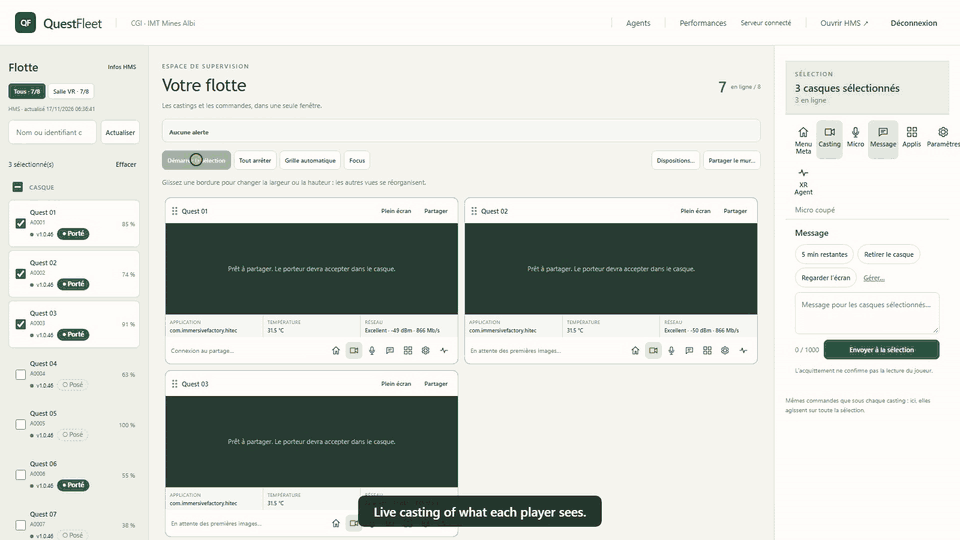

**English** · [Français](README.fr.md)

# QuestFleet

**A web dashboard and an agent on each Meta Quest let a teacher see, cast and command a whole room of headsets during a class.**

*The real dashboard, driven by demo headsets; the casting replays a recorded headset session. [Full video (0:59)](https://drive.google.com/file/d/1QW6jRf_f47qdaK_oXFmRfNSnW9uSUXTw/view)*

## Using it

- **Fleet.** Each headset with its name and group from Meta's console (HMS): online or unreachable, worn or set down, battery, agent version, alerts.
- **Casting.** Screen and sound of one or several headsets, the player's microphone, one view in large; a casting wall shared through a revocable link.
- **Messages.** Text shown in the headset over the running VR app, pre-written messages, voice messages to one or all headsets; each headset acknowledges.
- **Apps and settings.** Launch an app on the selection, set the volume, keep headsets awake with automatic screen wake-up, ring a headset to find it, vibrate its controllers while it is worn.
- **Agent updates.** HMS installs the agent; a headset behind the published version updates itself when it reports in.

## Architecture

## Status

- **Used** in the VR room of IMT Mines Albi from September to October 2026: 17 headsets with the agent, out of 38 in HMS; agent 1.0.46.
- **Since 6 November 2026** the server runs on the school's server, reachable only on its network. The headsets are not reconnected yet (agent update to come), and casting needs a TURN relay there.
- **Known limit.** A headset in deep sleep or switched off cannot be woken remotely.
- **Stack.** Android agent in Java (OpenXR for the controllers), FastAPI, SQLite, Mosquitto (MQTT over WebSocket), WebRTC (aiortc, coturn), Docker, GridStack; HMS bridge in Node.js with Playwright. Interface in French.

---

**Anthony Hunt** · [ingevision.cloud](https://ingevision.cloud/?lang=en&p=questfleet) · [LinkedIn](https://www.linkedin.com/in/anthony-hunt-3948a9196) · [GitHub](https://github.com/anthohunt)

The code and the fleet's data are private.
